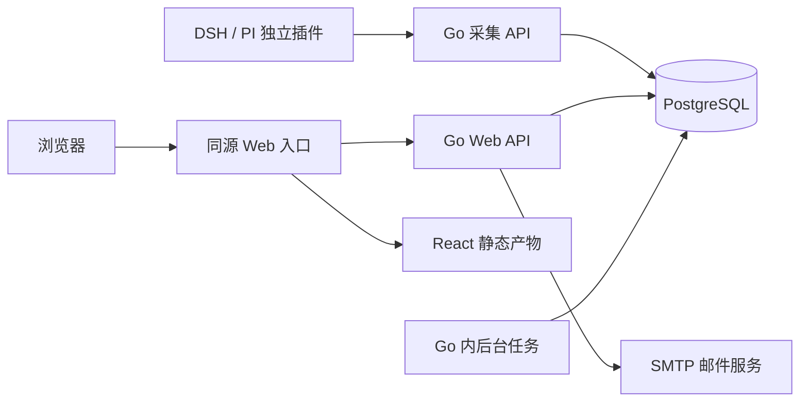

# TokenPivot 技术架构

> 状态：技术路线已确认；评审修正已纳入。关联 T-001。不是实施计划，不授权编码。

## 1. 目标与边界

以 [PRD](prd.md) 为产品依据。每日约 10 万事件是规划输入，不是已经验证的吞吐能力。官方 SaaS 与自托管使用同一核心服务。首版不提供模型代理、账单、预算告警、冷归档，不把视觉原型中的示例指标自动变成功能。

## 2. 系统结构

Go 单体提供采集、查询、认证、静态文件和后台任务；PostgreSQL 是唯一核心存储。首版不引入 Redis、Kafka、ClickHouse 或独立 worker。内部按身份与工作空间、采集、查询统计、维护任务划分职责，不提前建设通用存储抽象。

## 3. 独立前端工程与部署

计划中的 `web/` 是独立 Vite + React + TypeScript strict 工程，拥有自己的依赖、测试及构建。shadcn/ui + Tailwind 实现 F 极客风，采用响应式重排，不强制整屏缩放。

- 开发：Vite 提供页面，将 `/api` 代理至 Go。
- 自托管：前端构建产物可内嵌 Go；运行环境不需要 Node.js，仍需 PostgreSQL。
- 云端：允许静态资源独立托管或 CDN 发布，但浏览器访问页面与 API 必须同源（协议、主机、端口一致），由入口将 `/api` 路由至 Go。独立工程、独立发布不等于跨源认证。
- 真正跨源 Cookie 部署不属于首版隐式兼容范围，需要单独设计。
- 发布必须检查页面与 API 版本兼容；内嵌方式自然绑定产物，独立发布需部署顺序与旧资源保留策略。

TanStack Query 管服务端状态；筛选存 URL；查询键包含 workspace。本期只有个人空间，没有空间切换界面或接口，因此「切换时隔离旧数据、取消旧请求」这条规则暂不生效；T-020 引入多空间时必须实现它，即切换立即隔离旧数据、取消旧请求，不使用上一空间的占位数据，旧响应不得覆盖新页面。可见页面轮询间隔建议 5–10 秒，隐藏页暂停；此间隔不是端到端时效保证。ECharts 是待核验候选，微型字符图可用 SVG/DOM。依赖版本、图表库包体及用法为 TODO（待确认），实施前核验。

## 4. 接入流程与事务

1. 认证凭证，得到稳定 source 与 workspace；凭证轮换不改变 source。
2. 逐项校验格式、项目归属、时间及规范化业务字段。
3. 以服务端时间 T 校验 `occurred_at ∈ [T-180天,T]`；180 天指 180×24 小时。未来时间暂拒绝，不擅自改为接收时间；允许时钟偏差的具体规则仍待接口阶段确认。
4. 对有效项开事务，以 `(workspace_id, source_id, source_event_id)` 的唯一性接受事件；仅首次成功插入才增加对应分钟统计。
5. 同身份同规范化内容返回 duplicate，不同内容返回 conflict；提交后才返回 accepted。批次逐项独立提交，不是整批事务。
6. 永久无效与可重试失败区分返回；进程中断导致响应不确定时，插件用原身份重试。

业务内容比较包含发生时间、项目、模型、用量与质量信息等不可变事实，排除接收时间、凭证、JSON 字段顺序等传输差异。规范化版本与字段清单需在 OpenAPI 中冻结，不能随版本升级默默改变旧事件的哈希判定。

仅接受请求完成后的最终用量；来源只有区间汇总时不得拆成请求或分钟事件，先显示能力不可用，支持这种来源需要另定格式。未归属项目保留，跨空间或非法项目引用拒绝，不以“未归属”掩盖越权。

## 5. 保留与统计

采用 [ADR-0003](decisions/0003-minute-aggregation-and-retention.md) 的 A 方案：

- 原始事件和其中的防重依据：按首次 received_at 保留 180 天，重传不延长期限。
- 接受补报：只接受过去 180 天内发生的事件；过期返回 expired，先于 duplicate/conflict 判断。没有永久事件身份防重承诺，客户端不得复用事件 ID 或修改时间绕过窗口。
- 分钟统计：按 UTC 分钟起点保留 13 个日历月，过期桶按完整分钟清理。精确截止边界在接口中回传。
- 发生时间决定用量归属，接收时间用于采集新鲜度。补报更新历史桶，不冲高当前速率。

分钟表是趋势与排行共同来源，小时、天由同一数据按所选时区分组；缓存子集不叠加到总量。详见 [数据模型](data-model.md)。请求明细和精确滚动 60 秒读取原始事件。

### 查询边界

统一 `[start,end)`。普通历史统计接受分钟对齐范围；带秒的历史范围明确拒绝或提示用户确认对齐，不静默改变。当前未完成分钟允许展示，但显式标记未完成，返回统计截点。滚动 60 秒独立按精确时间查询，不使用相邻两个完整分钟代替。

自然小时/日以时区边界定义；夏令时重复小时使用包含偏移的唯一时间标识，不能仅按本地小时文本合并。不能假定每天 24 小时。超长分钟查询需显式粒度限制与提示，点数上限待接口阶段确定。

### 重建与恢复

按接收时间清理意味着晚到旧事件可能仍有部分明细，但不能据此认定整个旧时段完整。重建仅限发生时间在最近 180 天内、且从未因配置或事故丢失明细的完整分钟范围；服务起点与清理记录共同确定覆盖范围。

首版维护重建可暂停摄入和清理，对上报返回可重试错误，在事务内替换目标范围；失败回滚，范围外汇总不变。更老汇总不能由剩余明细重建，必须备份原始表和汇总表，并测试一致恢复。不实施在线双写重建框架。

## 6. 认证与安全

浏览器用主机范围、HttpOnly、生产 Secure、SameSite=Lax 的会话 Cookie；写请求采用严格 Origin 校验，拒绝不匹配或缺失的浏览器写来源。注册与登录已纳入限流；T-018 若恢复邀请与密码重置，同样必须纳入防护与限流设计。插件端点独立使用接入凭证，不回退到浏览器 Cookie 认证。

云端开放注册不使用 SMTP 验证邮箱：账号密码直接注册。T-016 已有基础注册与首个会话，T-017 只做注册开关，以及把个人空间初始化编排进这条现有注册事务，禁止再实现第二条注册路径；自托管可关闭公开注册。T-018 若恢复 SMTP 邮箱验证、邀请与密码重置，须另行决定存量未验证用户的规则，不以未验证回退替代。

注册与个人空间初始化是同一个数据库事务：用户、个人空间、owner 成员关系和首个会话任一步失败即整体回滚，不存在「稍后再补空间」的中间状态。个人空间展示名固定为 `Personal`，本期所有空间都是个人空间，没有空间类型、切换、邀请或成员管理；团队空间与成员管理由 T-020 另行规划。

owner 管理项目、凭证；member 查看使用数据。本期 owner 由注册时创建个人空间一并写入，用户与空间的关系只有 `workspace_memberships` 这一个来源，T-010/T-021 通过同一个成员角色查询（`(user_id, workspace_id) → owner/member`）判断权限，不各自查询成员表。插件由凭证固定归属。查询、唯一键、关联校验都包含 workspace。首版不启用 RLS，不能因此省略应用层授权。最后一个 owner 不得被移除（成员移除路径属 T-020，本期不实现）。凭证仅展示一次，保存摘要，不写日志。

浏览器对空间资源的所有读写（项目、来源、凭证）共用同一成员入口：写请求按 Origin → 会话 → 成员角色 → 资源 ID → 请求体的顺序处理，owner 可写、member 只读（凭证管理仍 owner-only）、非成员 403；成员角色或资源数据库故障是 500，会话存储故障是 503，二者不互相降级。所有资源 SQL 同时限定资源 ID 与 workspace_id，跨空间资源表现为 404。项目/来源的 DELETE 是保留历史的归档；来源归档与凭证签发/轮换在同一把来源行锁（READ COMMITTED 短事务）下串行，归档提交后不存在 active 凭证，采集认证本身不增加归档判断。归档前已认证的采集请求允许完成并写入历史，不承诺归档响应返回时所有旧请求已结束。后续聚合/明细查询必须复用同一 `requireMember` 与 workspace 限定。

## 7. 验收与未决事项

实施计划必须覆盖：并发/批内重复、丢响应重试、同 ID 冲突、轮换重试、180 天边界与清理竞态、迟到回填、缺失/估算用量、跨粒度一致、时区偏移和夏令时、重建中断、旧汇总备份恢复、跨空间攻击、同源两种部署、Cookie 写请求防护。多空间切换的慢响应验收归 T-020，届时连同切换界面一并实现。

每日约 10 万事件意味着 180 天约 1800 万原始事件；分钟聚合不保证显著压缩高基数数据。峰值、并发查询、机器规格、P95 目标、批量上限待确认后压测；同步写聚合未达目标再讨论异步，不预先实现备用路径。分区与全局唯一性必须一起评估，不让时间分区破坏业务防重键。

待确认：DSH/PI 字段及稳定身份、规范化样例、项目标识合并、时钟偏差、接口限额、具体依赖版本、性能环境、备份恢复目标。以上不阻碍路线确定，但接口和实施计划须先补齐。首个 owner 初始化已由 T-019 定为注册时创建个人空间一并写入，不再待确认。

## 8. 决策与研究

- [ADR-0001：单体与独立前端](decisions/0001-go-monolith-postgresql.md)
- [ADR-0002：采集幂等与批量](decisions/0002-ingestion-idempotency-and-batch.md)
- [ADR-0003：聚合与保留](decisions/0003-minute-aggregation-and-retention.md)
- [ADR-0004：身份与工作空间](decisions/0004-auth-and-workspace.md)
- [参考研究](research/2026-10-26-tokenpivot-ingestion-storage-reference.md)：借鉴逐项结果、业务身份、事件/接收时间和隔离测试；不复制参考项目代码、不照搬其计费、队列和分析集群。研究不是本项目性能证明。
