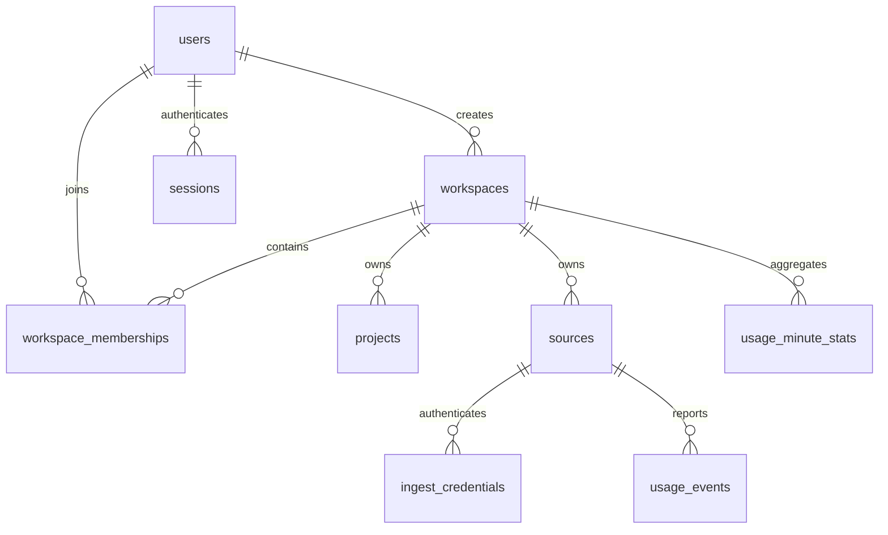

# TokenPivot 数据模型设计

> T-001 技术设计草案；核心边界已确认，字段与索引须经接口样例及压测后定稿。`workspaces`、`projects`、`sources`、`ingest_credentials` 四张基础表已由迁移 00002 实现，`usage_events` 由 00003（00009 追加两个可空计时列）、`usage_minute_stats` 由 00004、`users` 与 `sessions` 由 00005、`workspace_memberships` 由 00006 实现；其余表仍只是设计，不是数据库已实现的说明。

## 1. 关系



引用完整性在应用层校验；数据库使用主键、唯一索引、必要普通索引和 NOT NULL，不采用外键、CHECK、触发器或 RLS。所有租户关联须同时校验 workspace，不能只查全局 ID 存在。

## 2. 公共约定

ID 用 UUID v7，由数据库默认值 `uuidv7()` 生成，写入后用 `RETURNING id` 取回，因此服务端最低版本为 **PostgreSQL 18**（该函数自 18 起内置）。机器标识列（`project_key`、`platform`、`instance_key`）与 `workspaces.name` 使用 `COLLATE "C"`，按字节排序和判等，不随数据库 locale 与系统排序库版本变化；其余展示用列（如 `projects.name`）沿用数据库默认排序规则。时间为 timestamptz，存 UTC。Token 和计数用 bigint，禁止浮点存用量。业务字符串用 text；摘要值等二进制值用 bytea。必填默认 NOT NULL，可空字段逐项说明理由。数值范围、负数、溢出、引用与状态由应用层验证。索引命名规则：唯一索引 `uk_<表>_<列>`，普通索引 `idx_<表>_<列>`，主键索引用数据库默认名 `<表>_pkey`。字段名是设计建议，不是已发布接口。

## 3. 核心实体与访问路径

| 实体 | 核心字段/类型 | 唯一性与读写路径 |
|---|---|---|
| users | id uuid（默认 `uuidv7()`）；email text（`COLLATE "C"`，已规范化）；password_hash text（Argon2id 编码）；created_at timestamptz（默认 `now()`） | `uk_users_email` UNIQUE `(email)`；只存 TrimSpace + 小写后的规范化邮箱，按字节判等；不预建 `email_verified_at`：初期没有读写方，T-018 若恢复邮箱验证再以新迁移增加 |
| workspaces | id uuid（默认 `uuidv7()`）；created_by_user_id uuid；name text（`COLLATE "C"`）；created_at timestamptz（默认 `now()`） | `uk_workspaces_created_by_user_id_name` UNIQUE `(created_by_user_id,name)`：同账户名称精确唯一，索引前缀同时支持按创建者计数额度；`created_by_user_id` 不加外键，只用于额度与重名判定，不参与角色授权；name 非空、1–80 code point、≤256 字节 UTF-8、无控制字符由应用校验，大小写敏感且不做 Unicode 规范化；列表按成员关系 join 后以 `name COLLATE "C" ASC, id ASC` 排序 |
| workspace_memberships | workspace_id/user_id uuid；role text；joined_at timestamptz（默认 `now()`） | `uk_workspace_memberships_workspace_id_user_id` UNIQUE `(workspace_id,user_id)`：同一用户对同一空间只能有一条成员关系，其 `workspace_id` 前缀同时支持按空间查成员；`idx_workspace_memberships_user_id` `(user_id)` 支持按用户列出其加入的工作空间；**不**对 `user_id` 单独建唯一索引，一个用户可属于多个空间。role 只用 text：owner/member，创建事务写 owner，member 只读且本期没有写入入口 |
| projects | id/workspace_id uuid；project_key text（`COLLATE "C"`）；name text；archived_at timestamptz 可空；created_at timestamptz（默认 `now()`） | `uk_projects_workspace_id_project_key` UNIQUE `(workspace_id,project_key)`；唯一索引以 workspace_id 开头，兼作 workspace_id 引用索引并支持按空间列举。归档后 key 仍被占用（不用部分唯一索引）；归档不删除历史身份 |
| sources | id/workspace_id uuid；platform、instance_key text（均 `COLLATE "C"`）；last_received_at timestamptz 可空；archived_at timestamptz 可空（迁移 00007）；created_at timestamptz（默认 `now()`） | `uk_sources_workspace_id_platform_instance_key` UNIQUE `(workspace_id,platform,instance_key)`；代表稳定插件实例，不代表一次凭证；实例标识生成待插件核验。归档后标识仍被占用 |
| ingest_credentials | id/workspace_id/source_id uuid；secret_hash bytea；revoked_at timestamptz 可空；created_at timestamptz（默认 `now()`） | `uk_ingest_credentials_secret_hash` UNIQUE `(secret_hash)`：认证按完整令牌的 SHA-256 摘要等值查找，一个摘要只对应一条凭证；`idx_ingest_credentials_workspace_id_source_id` `(workspace_id,source_id)` 支持按空间或空间+source 列举；轮换创建新凭证但 source 不变，所以 source_id 不唯一 |
| sessions | id/user_id uuid；token_hash bytea；expires_at timestamptz（无默认值）；revoked_at timestamptz 可空；created_at timestamptz（默认 `now()`） | `uk_sessions_token_hash` UNIQUE `(token_hash)`：认证按完整 `tps_` 令牌的 SHA-256 摘要原始 32 字节等值查找；`idx_sessions_user_id` `(user_id)` 保留用户维度撤销/查询所需的引用索引；`revoked_at IS NULL` 且 `expires_at > now()` 才有效；每次有效认证用同一条 `UPDATE ... RETURNING` 把 `expires_at` 续到 30 天后；不预建过期清理索引，本任务没有清理任务 |
| auth_actions | id/user_id uuid；purpose/token_hash text；expires_at/consumed_at timestamptz（consumed 可空）；目标邮箱、邀请 workspace 按用途可空 | token_hash 唯一；一次性邮箱验证/重置/邀请；邀请场景 user_id 可空，按用途校验字段完整性；最终字段拆分待认证流程确认 |

已在迁移 00002 实现的四张表（workspaces、projects、sources、ingest_credentials）另有以下约定：服务角色 `tokenpivot_app` 在这四张表上只有 SELECT、INSERT、UPDATE 权限，不授予 DELETE、TRUNCATE、REFERENCES、TRIGGER，归档与撤销都用 UPDATE 完成；除 `archived_at`、`last_received_at`、`revoked_at` 三列可空外全部 NOT NULL；`created_at` 用于管理页排序与凭证签发时间审计；`secret_hash` 存 32 字节摘要原始字节，长度由应用保证，迁移不加 CHECK；表级 COMMENT 写英文，字段含义以本文件为准。这些都与早期设计草案有差异：新增 `created_at`、凭证索引改为 `(workspace_id, source_id)` 组合索引、ID 生成版本定为 UUID v7 的数据库默认值、`secret_hash` 由 text 改为 bytea 并加唯一索引（认证从“按公开 ID 定位”改为“按摘要查找”）。

迁移 00005 的 `users`、`sessions` 沿用同一套约定：`tokenpivot_app` 只在这两张表上有 SELECT、INSERT、UPDATE，不授予 DELETE、TRUNCATE 等，过期与撤销都用 UPDATE 完成；除 `sessions.revoked_at` 可空外全部 NOT NULL；没有外键、CHECK、触发器与 RLS，`sessions.user_id` 的引用完整性、摘要固定 32 字节和 30 天滑动期限都只由应用保证，迁移不加约束；`users.email` 与 `sessions.token_hash` 的唯一索引同时是认证查询路径，因此不再另建普通索引。

迁移 00006 的 `workspace_memberships` 沿用同一套约定：`tokenpivot_app` 在这一张表上只有 SELECT、INSERT，**没有** UPDATE/DELETE/TRUNCATE/REFERENCES/TRIGGER，所以服务角色既改不了角色也删不掉成员，成员变更与邀请要等 T-020 有真实操作后另行授权；四列全部 NOT NULL，`joined_at` 默认 `now()`；不建代理主键（身份就是 `(workspace_id,user_id)`），不建外键、CHECK、触发器与 RLS，引用完整性、角色取值和 `owner` 唯一性都只由应用保证，迁移不加约束。本期唯一的写路径是工作空间创建事务：插入 `workspaces` 后在同一事务写一条 `role=owner` 成员关系，注册事务不再写这张表；`member` 只有查询语义，没有写入入口。成员列表、邀请、角色变更、最后 owner 保护尚未实现；服务端不保存“当前工作空间”，前端在 URL 中选择并经 `GET /workspaces/{id}` 校验成员资格。

状态流转：凭证 active→revoked；会话 active→expired/revoked；一次性操作 pending→consumed/expired。消费采用条件更新，避免并发复用。成员变更需保护最后一个 owner。项目归档不回写旧事件，不做级联删除。凭证撤销或项目归档不清除防重记录。迁移 00007（T-054）为 `sources` 新增可空 `archived_at timestamptz`：无默认值、无回填、不加索引，旧行即 active；不改其他表，不加外键或级联。HTTP DELETE 对项目与来源都是归档（只写 `archived_at`，`COALESCE` 保留首次值），不物理删除，保留 `usage_events`、`usage_minute_stats`、来源与凭证行，不重新归属；归档行仍占用唯一键，删除后同键重建仍冲突；本期无恢复。来源归档在同一事务内锁来源行、写 `archived_at`，并把该来源下 `revoked_at IS NULL` 的凭证写 `revoked_at`（已撤销行、令牌摘要与 `source_id` 不变）；凭证签发/轮换与归档共用同一把来源行锁，已归档来源拒绝签发/轮换。来源 PATCH 只改 `platform`/`instance_key`。归档前已认证的采集请求可在归档后完成并更新 `last_received_at`。

### 工作空间创建与列表（T-064）

`workspaces` 自 T-064 起由用户手动创建，注册事务不再写入工作空间。修改既有迁移 00002 后，空库重建的 `workspaces` 结构为：

```sql
CREATE TABLE workspaces (
    id uuid PRIMARY KEY DEFAULT uuidv7(),
    created_by_user_id uuid NOT NULL,
    name text COLLATE "C" NOT NULL,
    created_at timestamptz NOT NULL DEFAULT now()
);
CREATE UNIQUE INDEX uk_workspaces_created_by_user_id_name ON workspaces (created_by_user_id, name);
```

`created_by_user_id` 不加 FK，只用于额度计数和同账户名称唯一，不参与运行时角色判定；索引前缀同时支持按创建者计数。创建在一个短事务内按固定顺序完成：`SELECT 1 FROM users WHERE id = $1 FOR UPDATE` 锁账户 → `SELECT count(*) FROM workspaces WHERE created_by_user_id = $1` → 插入 `workspaces` → 插入 `(workspace_id,user_id,'owner')` 成员关系。计数达到 2 返回额度错误，任一步失败整体回滚。事务使用默认 `READ COMMITTED`，同一账户的并发创建被 `users` 行锁串行化，不同账户互不阻塞；同账户重名由 `uk_workspaces_created_by_user_id_name` 兜底，只有该索引冲突映射为 `409 WORKSPACE_NAME_CONFLICT`，其他唯一冲突仍按内部错误处理，超额返回 `409 WORKSPACE_LIMIT_REACHED`。

名称由应用在事务外校验：`TrimSpace` 后 1–80 个 Unicode code point、UTF-8 不超过 256 字节、不含控制字符；大小写敏感，不做 Unicode 规范化，`Alpha` 与 `alpha` 可共存。数据库保存修剪后的值，`COLLATE "C"` 使判等和排序都按字节进行。

列表按 `workspace_memberships.user_id` join `workspaces`，只返回当前用户作为成员的空间，按 `name COLLATE "C" ASC, id ASC` 排序，不分页，空成员关系返回空数组。详情先经 `MembershipRole` 校验成员资格，再按已验证的 workspace ID 读取名称；非成员与不存在都返回 `403`，不泄露资源是否存在。服务端不保存“当前工作空间”，前端在 URL 中选择并由详情接口每次重新校验。

本次修改既有迁移 00002，按最新结构从空库重建，不做旧库回填或兼容升级；真实部署库的重建步骤（DSN、停服与执行方式）为 TODO(待确认)，本文件不声称已在部署环境生效。

## 4. usage_events：不可变最终事件

| 字段 | 类型/空值 | 用途 |
|---|---|---|
| id | uuid，必填 | 内部事件身份，也是明细游标的次序键；数据库默认 `uuidv7()` |
| workspace_id/source_id | uuid，必填 | 服务端认证归属；source_id 是稳定的插件实例，不是凭证 ID |
| source_event_id | text，必填 | 插件稳定业务事件 ID，不得复用；排序规则 COLLATE "C"，相等即逐字节相同，不受 locale 升级影响 |
| normalization_version | text，必填 | 比较依据所属的规范化算法版本 |
| payload_hash | bytea，必填 | 规范化业务内容的原始摘要字节（SHA-256 的 32 字节），按字节比较，不用十六进制文本 |
| project_id | uuid，可空 | NULL 只表示未归属；非法或跨空间 ID 由入口拒绝，不得降为 NULL |
| provider/model | text，必填 | 独立维度，别名合并规则未定前按原身份区分 |
| occurred_at/received_at | timestamptz，必填，无默认值 | 完成时刻/首次成功接收时刻；重传不改写，也不让数据库默默选时钟 |
| input_tokens/output_tokens/total_tokens | bigint，可空 | 未知不能当零；total 按可验证归一化规则生成 |
| cache_read_tokens/cache_write_tokens/reasoning_tokens | bigint，可空 | 来源可获取的子集，不额外加到 total |
| `<metric>_quality`（每个指标一列） | text，必填 | known/estimated/missing，禁止只用一个全局完整标记掩盖分字段差异；指标值为 NULL 当且仅当质量为 missing，由入口校验，迁移不加 CHECK |
| status/duration_ms | text / bigint，可空 | 来源不可得时为空；不用这些字段虚构延迟分位数 |
| generation_duration_ms/ttft_ms | bigint，可空，无默认值 | 迁移 00009 新增；客户端观测的 decode 时长与首 token 延迟（毫秒），只用原始整数，不存派生速度。来源不可得时为空，**不回填历史行**；`0` 是真实观测，NULL 才是未知 |

不加 created_at/updated_at：received_at 已是写入时间，行不可变；也不存原始报文或 jsonb，比较集合已落成列。

数据库唯一键：`(workspace_id,source_id,source_event_id)`，约束名 `uk_usage_events_workspace_id_source_id_source_event_id`，不能用“先查后插”替代。只在首次成功插入时更新分钟汇总，两个写入在同一事务内。生产 SQL 的约定：冲突目标只用这三列推断，冲突动作只用 `DO NOTHING`；身份查询三列齐全；不对本表加行锁；只有身份键竞争走 duplicate/conflict 路径，其他 23505 属存储失败。

已建索引：主键 `(id)`；身份键唯一约束（其前缀 `(workspace_id,source_id)` 同时覆盖按 source 的访问，所以不再单建 source_id 索引）；`idx_usage_events_workspace_id_occurred_at_id` `(workspace_id,occurred_at,id)` 支持明细游标、60 秒滚动用量与生成速度（`usage-speed`，最近 60 分钟逐分钟分组也走它）；`idx_usage_events_received_at` `(received_at)` 支持按首次接收时间的保留清理。不建 project_id 索引：项目只归档不删除、不级联，没有“删父行前检查”的路径；按项目筛选的组合索引由查询任务按 EXPLAIN 增补。其他组合筛选索引同样按真实访问路径决定，不预建所有排列。

权限与不可变：服务角色 `tokenpivot_app` 在本表上只有 SELECT、INSERT，不授予 UPDATE、DELETE、TRUNCATE、REFERENCES、TRIGGER。因此 `UPDATE`、`ON CONFLICT DO UPDATE`、`SELECT … FOR SHARE` 对服务角色都因权限不足失败，即使 SQL 写错也无法覆盖内容或续期 received_at；清理所需的 DELETE 由保留清理任务在自己的迁移里另行授权。无 RLS 时租户隔离靠每条 SQL 都带认证得到的 workspace_id，由写入与读查询任务各自实现并测试。

比较依据与校验边界：持久化 normalization_version、payload_hash 和比较集合的每个字段（按冻结精度成列）；跨版本比较须基于实际留存信息，类型化列不保证能按新规则无损重建。数据库不校验摘要与列是否一致、不校验非负与取值范围、不建外键与 CHECK；这些都由入口校验一次，存储层不重复。

规范化版本与新增计时列：`normalization_version` 目前有两个已知值，`tokenpivot-usage-event/v1`（比较集合 7 个元素）与 `tokenpivot-usage-event/v2`（在 v1 之后追加 `generation_duration_ms`、`ttft_ms`，共 9 个元素）。请求里两个计时属性都未出现时按 v1 落库，出现任一个时按 v2 落库（显式 `null` 也算出现）。已知 v1 与 v2 的共同比较版本固定为 v1：v2 是纯追加，v1 的每列都保留，因此 v2 旧行能用留存列重建 v1 摘要，v1 请求也能投影到 v1。两端任一是未知版本时返回 `NORMALIZATION_INCOMPATIBLE`。两列不参与分钟聚合，也不改动事件身份与既有用量。

保留按首次 received_at 180 天。时间有效性校验先于查重：过期返回 expired，不要求继续识别 duplicate/conflict。清理与有效写入边界使用一致服务端截点；未来事件不进入表。修改 occurred_at 是修改业务内容，不是合法重试；超出防重期限后不承诺识别被篡改身份。

## 5. usage_minute_stats：可加统计与质量覆盖

物理唯一键：`(workspace_id,bucket_start,source_id,project_id,provider,model)`，约束名 `usage_minute_stats_key`，已由迁移 00004 用 `UNIQUE NULLS NOT DISTINCT` 实现：未归属事件存 `project_id` 为 NULL，这些行参与同一个唯一仲裁，不会分裂成多个未归属桶。逻辑上的 project_group 就映射到这一列，不另设哨兵 UUID 或生成列。

- bucket_start 为 `occurred_at` 的 UTC 分钟起点（`.UTC().Truncate(time.Minute)`），不读会话时区，也不用 received_at。
- 包含 source 维度，防止来源能力与完整性统计丢失；凭证 ID 不进入聚合键，也不在输入中。
- 对 input/output/total/cache_read/cache_write/reasoning 六类 token 分别保存：可为 known/estimated 值之和的 `*_sum`、`*_known_count`、`*_estimated_count`、`*_missing_count`；估算值计入可展示和时同时携带估算标记。所有 sum/count 均 NOT NULL 且无默认值，迁移逐列展开六组指标。
- event_count 只用于已接受事件数，每次写入固定加 1。首版仅请求级最终事件时可作为请求数；汇总级事件被写入端拒绝，未来支持汇总事件需显式新增请求数语义。
- 不变量：每个桶每个指标的 known_count + estimated_count + missing_count = event_count；sum 是所有 known/estimated 输入值之和，missing 不贡献值。全部缺失返回不可用，部分缺失返回已知部分与覆盖信息，而非伪装完整总量。真实零具有已知计数。
- 比例、缓存率在查询时按正确分母计算，不存百分比再平均。不从分钟平均值计算 p95，不承诺原型里的费用/预算/延迟分位数。

已建索引只有唯一约束自带的那一条，其 `(workspace_id,bucket_start,...)` 前缀同时支持按 workspace 的时间范围访问，因此不再单建重复的 workspace+bucket 索引。按 source 或按项目筛选的组合索引**暂缓、尚未建成**，由查询任务（T-024/T-027）按真实访问路径和 `EXPLAIN` 决定是否新增。高基数情况下分钟表可能接近事件数，需要以真实数据压测存储和查询。

权限与写入方式：服务角色 `tokenpivot_app` 在本表上有 SELECT、INSERT、UPDATE（`ON CONFLICT DO UPDATE` 自加需要），不授予 DELETE、TRUNCATE、REFERENCES、TRIGGER。增量只由调用方事务内一条参数化 UPSERT 完成：冲突目标为上述六列推断，更新一律 `现有值 + EXCLUDED`，没有 WHERE、不先 SELECT 再写回、不在写入端重试；明细插入与分钟增量共享同一个事务，失败由调用方整体回滚。

## 6. 归一化样例（验收输入，不代表已核实插件能力）

| 输入 | 统计预期 |
|---|---|
| input=0, output=0，均已知 | total=0，完整；不是无数据 |
| input=100, output=20, cache_read=60（输入子集） | total=120，不能算成180 |
| output=20, reasoning=8（输出子集） | output仍20，不能变28 |
| input=100, output缺失 | 输入已知，输出不可用；不能推导total=100为完整总量 |
| 只有来源total=120 | 仅在格式明确该total可比时保留；输入输出不可用，不反推拆分 |
| input为估算100，output已知20 | total携带估算标记；不能标成全部实测 |
| 两请求：一个output=20，一个output缺失 | output已知和20，missing_count=1，不称完整输出 |
| 只有一小时汇总 | 不接受为请求级分钟事件，不虚构请求数 |

TODO（待确认）：来源仅总量的标准字段、来源总量与分项不一致时的取舍，须经 DSH/PI 样例验证并写入 OpenAPI。正式接入前不得按未核实样例静默归一化。

## 7. 清理、重建与大表

分钟数据按 bucket_start 保留13个日历月；明细按 received_at 保留180天。晚到事件可能让部分更老发生时段仍有明细，但不允许重建不完整旧桶。只重建已证明完整的范围，暂停摄入与清理后事务替换，其他范围不变。备份必须包含超过明细覆盖期的汇总。

约1800万明细行的规划量需要评估分区，但时间分区不能破坏跨分区的业务唯一性。首版物理分区策略、清理批量、恢复目标和精确索引须在实施计划确认；不在路线阶段生成未经验证的DDL。明细首版（迁移 00003）落为普通表、不分区，索引按上文已建的四条固定；分区与清理批量留待后续任务在真实数据下另行评估。

完整事务、安全及验收规则见 [架构](architecture.md)；本文件与后续迁移须同步维护。
