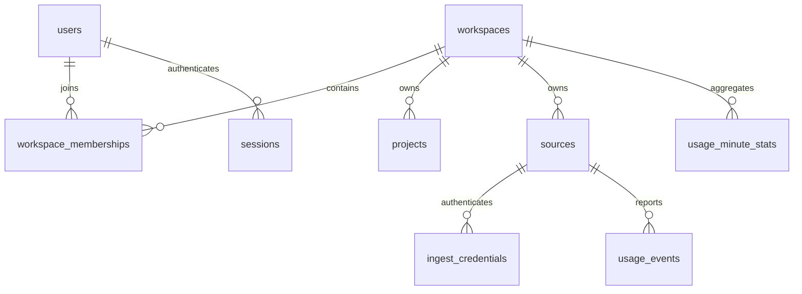

# TokenPivot 数据模型设计

> T-001 技术设计草案；核心边界已确认，字段与索引须经接口样例及压测后定稿。`workspaces`、`projects`、`sources`、`ingest_credentials` 四张基础表已由迁移 00002 实现，其余表仍只是设计，不是数据库已实现的说明。

## 1. 关系

引用完整性在应用层校验；数据库使用主键、唯一索引、必要普通索引和 NOT NULL，不采用外键、CHECK、触发器或 RLS。所有租户关联须同时校验 workspace，不能只查全局 ID 存在。

## 2. 公共约定

ID 用 UUID v7，由数据库默认值 `uuidv7()` 生成，写入后用 `RETURNING id` 取回，因此服务端最低版本为 **PostgreSQL 18**（该函数自 18 起内置）。机器标识列（`project_key`、`platform`、`instance_key`）使用 `COLLATE "C"`，按字节排序和判等，不随数据库 locale 与系统排序库版本变化；`name` 一类展示用列沿用数据库默认排序规则。时间为 timestamptz，存 UTC。Token 和计数用 bigint，禁止浮点存用量。业务字符串用 text；摘要值等二进制值用 bytea。必填默认 NOT NULL，可空字段逐项说明理由。数值范围、负数、溢出、引用与状态由应用层验证。索引命名规则：唯一索引 `uk_<表>_<列>`，普通索引 `idx_<表>_<列>`，主键索引用数据库默认名 `<表>_pkey`。字段名是设计建议，不是已发布接口。

## 3. 核心实体与访问路径

| 实体 | 核心字段/类型 | 唯一性与读写路径 |
|---|---|---|
| users | id uuid；email text；password_hash text；email_verified_at timestamptz 可空（未验证） | 规范化 email 唯一；按 ID/邮箱登录查询，验证和重置更新 |
| workspaces | id uuid（默认 `uuidv7()`）；name text；created_at timestamptz（默认 `now()`） | 只有主键；name 不唯一，非空与长度由应用校验；成员列表按 workspace 关联查询 |
| workspace_memberships | workspace_id/user_id uuid；role text；joined_at timestamptz | `(workspace_id,user_id)` 唯一；另支持 user_id 查空间；role=owner/member |
| projects | id/workspace_id uuid；project_key text（`COLLATE "C"`）；name text；archived_at timestamptz 可空；created_at timestamptz（默认 `now()`） | `uk_projects_workspace_id_project_key` UNIQUE `(workspace_id,project_key)`；唯一索引以 workspace_id 开头，兼作 workspace_id 引用索引并支持按空间列举。归档后 key 仍被占用（不用部分唯一索引）；归档不删除历史身份 |
| sources | id/workspace_id uuid；platform、instance_key text（均 `COLLATE "C"`）；last_received_at timestamptz 可空；created_at timestamptz（默认 `now()`） | `uk_sources_workspace_id_platform_instance_key` UNIQUE `(workspace_id,platform,instance_key)`；代表稳定插件实例，不代表一次凭证；实例标识生成待插件核验 |
| ingest_credentials | id/workspace_id/source_id uuid；secret_hash bytea；revoked_at timestamptz 可空；created_at timestamptz（默认 `now()`） | `uk_ingest_credentials_secret_hash` UNIQUE `(secret_hash)`：认证按完整令牌的 SHA-256 摘要等值查找，一个摘要只对应一条凭证；`idx_ingest_credentials_workspace_id_source_id` `(workspace_id,source_id)` 支持按空间或空间+source 列举；轮换创建新凭证但 source 不变，所以 source_id 不唯一 |
| sessions | id/user_id uuid；token_hash text；expires_at timestamptz | token_hash 唯一；user_id 索引用于撤销；expires_at 支持清理 |
| auth_actions | id/user_id uuid；purpose/token_hash text；expires_at/consumed_at timestamptz（consumed 可空）；目标邮箱、邀请 workspace 按用途可空 | token_hash 唯一；一次性邮箱验证/重置/邀请；邀请场景 user_id 可空，按用途校验字段完整性；最终字段拆分待认证流程确认 |

已在迁移 00002 实现的四张表（workspaces、projects、sources、ingest_credentials）另有以下约定：服务角色 `tokenpivot_app` 在这四张表上只有 SELECT、INSERT、UPDATE 权限，不授予 DELETE、TRUNCATE、REFERENCES、TRIGGER，归档与撤销都用 UPDATE 完成；除 `archived_at`、`last_received_at`、`revoked_at` 三列可空外全部 NOT NULL；`created_at` 用于管理页排序与凭证签发时间审计；`secret_hash` 存 32 字节摘要原始字节，长度由应用保证，迁移不加 CHECK；表级 COMMENT 写英文，字段含义以本文件为准。这些都与早期设计草案有差异：新增 `created_at`、凭证索引改为 `(workspace_id, source_id)` 组合索引、ID 生成版本定为 UUID v7 的数据库默认值、`secret_hash` 由 text 改为 bytea 并加唯一索引（认证从“按公开 ID 定位”改为“按摘要查找”）。

状态流转：凭证 active→revoked；会话 active→expired/revoked；一次性操作 pending→consumed/expired。消费采用条件更新，避免并发复用。成员变更需保护最后一个 owner。项目归档不回写旧事件，不做级联删除。凭证撤销或项目归档不清除防重记录。当前 `sources` 没有 `archived_at`，source 生命周期字段要等出现真实需求时由管理任务另起迁移新增，不在 00002 预留。

## 4. usage_events：不可变最终事件

| 字段 | 类型/空值 | 用途 |
|---|---|---|
| id | uuid，必填 | 内部事件身份，也是明细游标的次序键；数据库默认 `uuidv7()` |
| workspace_id/source_id | uuid，必填 | 服务端认证归属；source_id 是稳定的插件实例，不是凭证 ID |
| source_event_id | text，必填 | 插件稳定业务事件 ID，不得复用；排序规则 COLLATE "C"，相等即逐字节相同，不受 locale 升级影响 |
| normalization_version | text，必填 | 比较依据所属的规范化算法版本 |
| payload_hash | bytea，必填 | 规范化业务内容的原始摘要字节（SHA-256 的 32 字节），按字节比较，不用十六进制文本 |
| project_id | uuid，可空 | NULL 只表示未归属；非法或跨空间 ID 由入口拒绝，不得降为 NULL |
| provider/model | text，必填 | 独立维度，别名合并规则未定前按原身份区分 |
| occurred_at/received_at | timestamptz，必填，无默认值 | 完成时刻/首次成功接收时刻；重传不改写，也不让数据库默默选时钟 |
| input_tokens/output_tokens/total_tokens | bigint，可空 | 未知不能当零；total 按可验证归一化规则生成 |
| cache_read_tokens/cache_write_tokens/reasoning_tokens | bigint，可空 | 来源可获取的子集，不额外加到 total |
| `<metric>_quality`（每个指标一列） | text，必填 | known/estimated/missing，禁止只用一个全局完整标记掩盖分字段差异；指标值为 NULL 当且仅当质量为 missing，由入口校验，迁移不加 CHECK |
| status/duration_ms | text / bigint，可空 | 来源不可得时为空；不用这些字段虚构延迟分位数 |

不加 created_at/updated_at：received_at 已是写入时间，行不可变；也不存原始报文或 jsonb，比较集合已落成列。

数据库唯一键：`(workspace_id,source_id,source_event_id)`，约束名 `uk_usage_events_workspace_id_source_id_source_event_id`，不能用“先查后插”替代。只在首次成功插入时更新分钟汇总，两个写入在同一事务内。生产 SQL 的约定：冲突目标只用这三列推断，冲突动作只用 `DO NOTHING`；身份查询三列齐全；不对本表加行锁；只有身份键竞争走 duplicate/conflict 路径，其他 23505 属存储失败。

已建索引：主键 `(id)`；身份键唯一约束（其前缀 `(workspace_id,source_id)` 同时覆盖按 source 的访问，所以不再单建 source_id 索引）；`idx_usage_events_workspace_id_occurred_at_id` `(workspace_id,occurred_at,id)` 支持明细游标与 60 秒滚动速率；`idx_usage_events_received_at` `(received_at)` 支持按首次接收时间的保留清理。不建 project_id 索引：项目只归档不删除、不级联，没有“删父行前检查”的路径；按项目筛选的组合索引由查询任务按 EXPLAIN 增补。其他组合筛选索引同样按真实访问路径决定，不预建所有排列。

权限与不可变：服务角色 `tokenpivot_app` 在本表上只有 SELECT、INSERT，不授予 UPDATE、DELETE、TRUNCATE、REFERENCES、TRIGGER。因此 `UPDATE`、`ON CONFLICT DO UPDATE`、`SELECT … FOR SHARE` 对服务角色都因权限不足失败，即使 SQL 写错也无法覆盖内容或续期 received_at；清理所需的 DELETE 由保留清理任务在自己的迁移里另行授权。无 RLS 时租户隔离靠每条 SQL 都带认证得到的 workspace_id，由写入与读查询任务各自实现并测试。

比较依据与校验边界：持久化 normalization_version、payload_hash 和比较集合的每个字段（按冻结精度成列）；跨版本比较须基于实际留存信息，类型化列不保证能按新规则无损重建。数据库不校验摘要与列是否一致、不校验非负与取值范围、不建外键与 CHECK；这些都由入口校验一次，存储层不重复。

保留按首次 received_at 180 天。时间有效性校验先于查重：过期返回 expired，不要求继续识别 duplicate/conflict。清理与有效写入边界使用一致服务端截点；未来事件不进入表。修改 occurred_at 是修改业务内容，不是合法重试；超出防重期限后不承诺识别被篡改身份。

## 5. usage_minute_stats：可加统计与质量覆盖

物理唯一键：`(workspace_id,bucket_start,source_id,project_id,provider,model)`，约束名 `usage_minute_stats_key`，已由迁移 00004 用 `UNIQUE NULLS NOT DISTINCT` 实现：未归属事件存 `project_id` 为 NULL，这些行参与同一个唯一仲裁，不会分裂成多个未归属桶。逻辑上的 project_group 就映射到这一列，不另设哨兵 UUID 或生成列。

- bucket_start 为 `occurred_at` 的 UTC 分钟起点（`.UTC().Truncate(time.Minute)`），不读会话时区，也不用 received_at。
- 包含 source 维度，防止来源能力与完整性统计丢失；凭证 ID 不进入聚合键，也不在输入中。
- 对 input/output/total/cache_read/cache_write/reasoning 六类 token 分别保存：可为 known/estimated 值之和的 `*_sum`、`*_known_count`、`*_estimated_count`、`*_missing_count`；估算值计入可展示和时同时携带估算标记。所有 sum/count 均 NOT NULL 且无默认值，迁移逐列展开六组指标。
- event_count 只用于已接受事件数，每次写入固定加 1。首版仅请求级最终事件时可作为请求数；汇总级事件被写入端拒绝，未来支持汇总事件需显式新增请求数语义。
- 不变量：每个桶每个指标的 known_count + estimated_count + missing_count = event_count；sum 是所有 known/estimated 输入值之和，missing 不贡献值。全部缺失返回不可用，部分缺失返回已知部分与覆盖信息，而非伪装完整总量。真实零具有已知计数。
- 比例、缓存率在查询时按正确分母计算，不存百分比再平均。不从分钟平均值计算 p95，不承诺原型里的费用/预算/延迟分位数。

已建索引只有唯一约束自带的那一条，其 `(workspace_id,bucket_start,...)` 前缀同时支持按 workspace 的时间范围访问，因此不再单建重复的 workspace+bucket 索引。按 source 或按项目筛选的组合索引**暂缓、尚未建成**，由查询任务（T-024/T-027）按真实访问路径和 `EXPLAIN` 决定是否新增。高基数情况下分钟表可能接近事件数，需要以真实数据压测存储和查询。

权限与写入方式：服务角色 `tokenpivot_app` 在本表上有 SELECT、INSERT、UPDATE（`ON CONFLICT DO UPDATE` 自加需要），不授予 DELETE、TRUNCATE、REFERENCES、TRIGGER。增量只由调用方事务内一条参数化 UPSERT 完成：冲突目标为上述六列推断，更新一律 `现有值 + EXCLUDED`，没有 WHERE、不先 SELECT 再写回、不在写入端重试；明细插入与分钟增量共享同一个事务，失败由调用方整体回滚。

## 6. 归一化样例（验收输入，不代表已核实插件能力）

| 输入 | 统计预期 |
|---|---|
| input=0, output=0，均已知 | total=0，完整；不是无数据 |
| input=100, output=20, cache_read=60（输入子集） | total=120，不能算成180 |
| output=20, reasoning=8（输出子集） | output仍20，不能变28 |
| input=100, output缺失 | 输入已知，输出不可用；不能推导total=100为完整总量 |
| 只有来源total=120 | 仅在格式明确该total可比时保留；输入输出不可用，不反推拆分 |
| input为估算100，output已知20 | total携带估算标记；不能标成全部实测 |
| 两请求：一个output=20，一个output缺失 | output已知和20，missing_count=1，不称完整输出 |
| 只有一小时汇总 | 不接受为请求级分钟事件，不虚构请求数 |

TODO（待确认）：来源仅总量的标准字段、来源总量与分项不一致时的取舍，须经 DSH/PI 样例验证并写入 OpenAPI。正式接入前不得按未核实样例静默归一化。

## 7. 清理、重建与大表

分钟数据按 bucket_start 保留13个日历月；明细按 received_at 保留180天。晚到事件可能让部分更老发生时段仍有明细，但不允许重建不完整旧桶。只重建已证明完整的范围，暂停摄入与清理后事务替换，其他范围不变。备份必须包含超过明细覆盖期的汇总。

约1800万明细行的规划量需要评估分区，但时间分区不能破坏跨分区的业务唯一性。首版物理分区策略、清理批量、恢复目标和精确索引须在实施计划确认；不在路线阶段生成未经验证的DDL。明细首版（迁移 00003）落为普通表、不分区，索引按上文已建的四条固定；分区与清理批量留待后续任务在真实数据下另行评估。

完整事务、安全及验收规则见 [架构](architecture.md)；本文件与后续迁移须同步维护。
